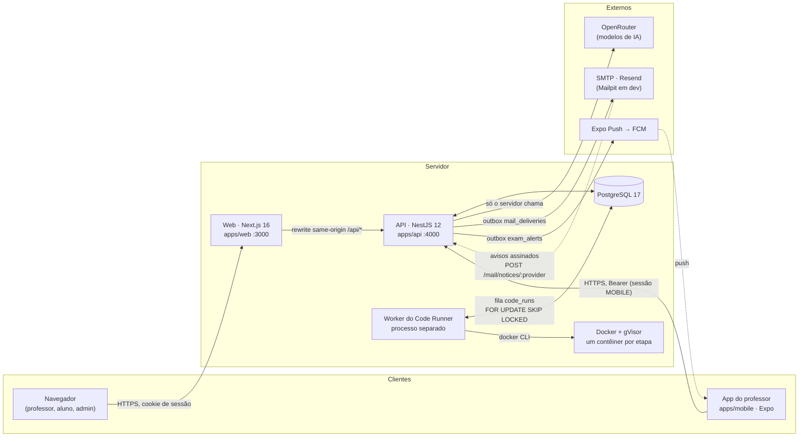
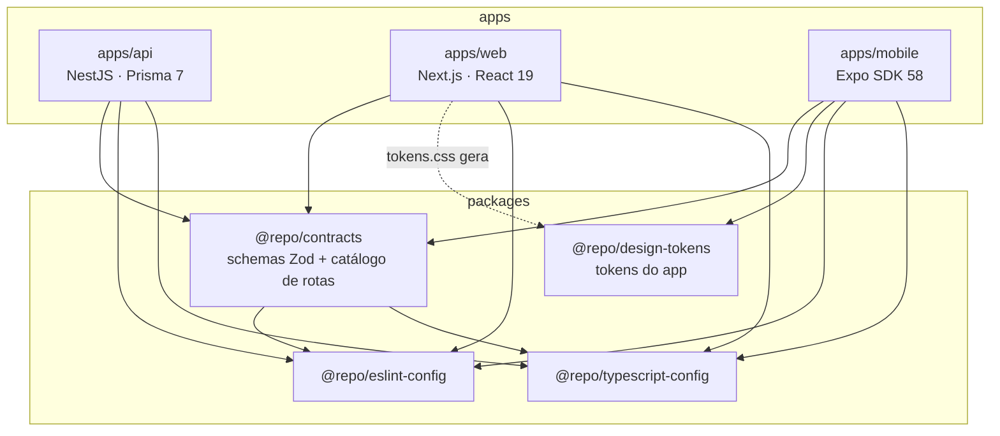
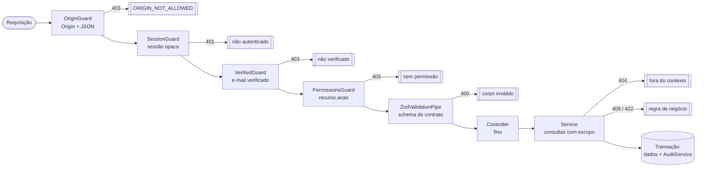
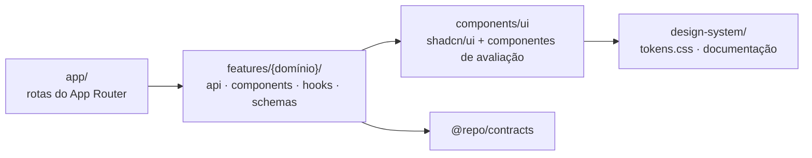
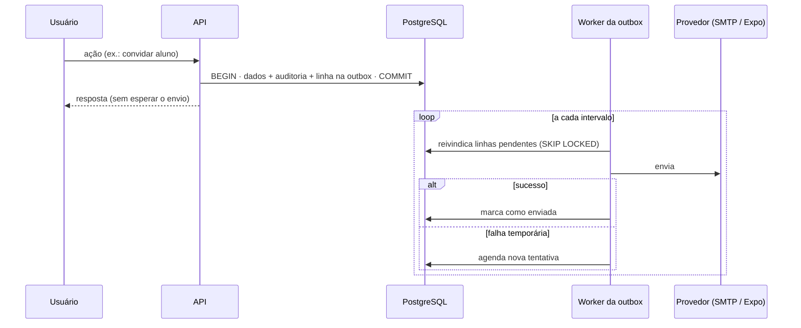
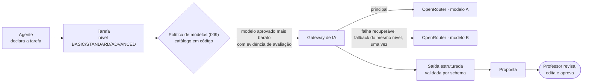
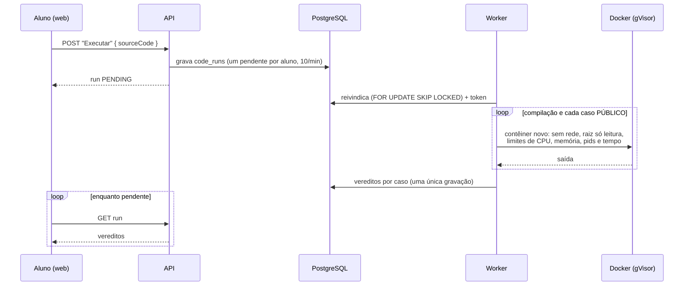
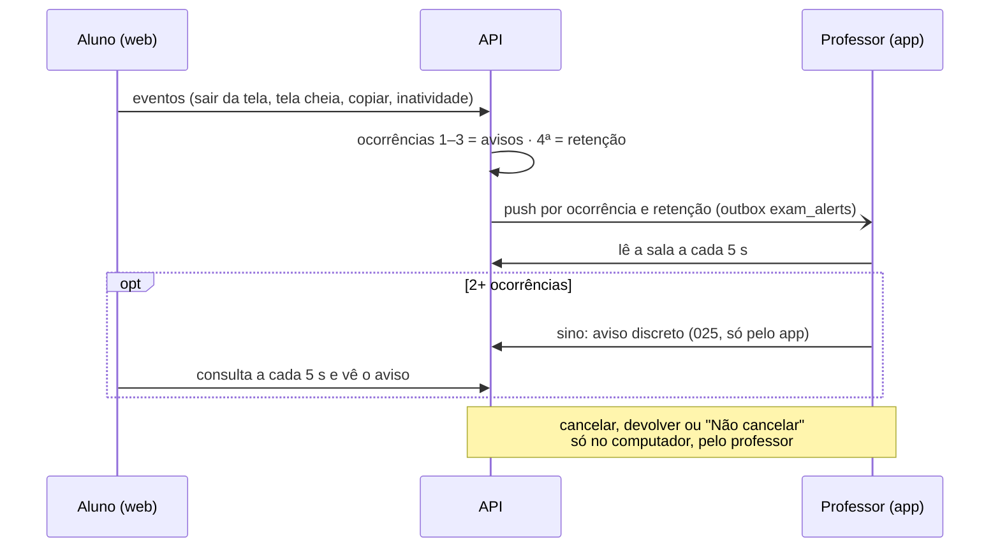
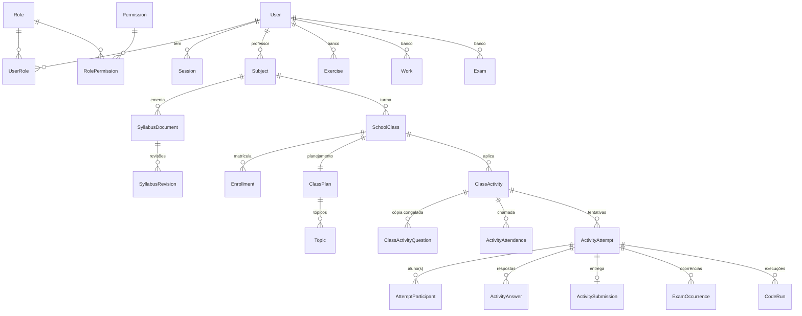
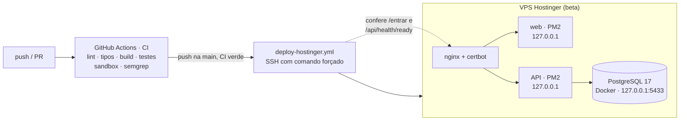

# DevTrack

Plataforma de ensino e avaliação configurável por professor: disciplinas e ementas, planejamento de aulas,
bancos privados de exercícios, trabalhos e provas (manuais ou gerados com IA revisada pelo professor), portal do
aluno com modo controlado, provas com avisos e decisão do professor, execução de código isolada, trabalho em
grupo e um app de celular para o professor acompanhar as provas.

As fases 001 a 025 estão implementadas; cada uma tem a sua spec em [`specs/`](specs/) e está resumida em
[Fases](#fases).

## Sumário

- [Visão geral](#visão-geral)
- [Arquitetura](#arquitetura)
  - [Componentes](#componentes)
  - [Monorepo](#monorepo)
  - [Pipeline de uma requisição](#pipeline-de-uma-requisição)
  - [Camadas da API e do web](#camadas-da-api-e-do-web)
  - [Trabalho em segundo plano, sem filas externas](#trabalho-em-segundo-plano-sem-filas-externas)
  - [IA](#ia)
  - [Code Runner](#code-runner)
  - [Prova, monitor no celular e avisos](#prova-monitor-no-celular-e-avisos)
  - [Modelo de dados](#modelo-de-dados)
  - [Segurança](#segurança)
  - [Implantação](#implantação)
- [Fases](#fases)
- [Pré-requisitos](#pré-requisitos) · [Estrutura](#estrutura) · [Primeiros passos](#primeiros-passos) ·
  [Comandos](#comandos) · [CI](#ci) · [Configuração](#configuração) · [Como o projeto evolui](#como-o-projeto-evolui)

## Visão geral

| Papel | O que faz na plataforma |
|-------|-------------------------|
| **Professor** (`TEACHER`) | Disciplinas, ementas (com "Preencher com IA"), calendário e planejamento da turma; bancos de exercícios, trabalhos e provas; convida alunos; aplica atividades com chamada, modo controlado, ajuda da IA, execução de código e grupos; corrige, libera notas e decide as retenções das provas; acompanha as provas pelo app do celular |
| **Aluno** (`STUDENT`) | Entra só por convite de turma; painel, atividades, histórico, ranking dos exercícios; responde com salvamento automático, executa código, pede ajuda à IA, faz provas e trabalhos em grupo; envia feedback à plataforma |
| **Gestor** (`MANAGER`) | Convida professores |
| **Administrador** (`ADMIN`) | Convida gestores e professores, opera a IA ("Operação de IA": agentes, modelos, custos, orçamentos) e trata os feedbacks dos alunos. O primeiro só nasce pela CLI |

Uma pessoa é uma única identidade (`User`) com um ou mais papéis; cada ação exige uma permissão explícita
(`recurso.acao`) **e** que o recurso pertença ao contexto do usuário.

## Arquitetura

### Componentes



- O navegador nunca fala direto com a API: o Next.js repassa `/api/*` para ela, então cookie e origem são os
  mesmos do site. `proxy.ts` do web só redireciona por experiência de uso; quem autoriza é sempre a API.
- O worker do Code Runner é outro processo (`dist/code-runner/main.js`), que a API nunca importa. Os dois só
  se encontram nas tabelas da fila.
- Não há Redis, fila externa nem WebSockets: o trabalho em segundo plano usa tabelas do PostgreSQL, e as
  telas que mudam sozinhas consultam a API a cada 5 s.

### Monorepo

pnpm workspaces + Turborepo. Todo contrato entre API, web e app é um schema Zod em `@repo/contracts`.



- `packages/contracts` não importa Prisma, Nest nem React e não traz texto de interface; `endpoints.ts` lista
  cada rota com os schemas de pedido e resposta, e os tipos saem de `z.infer`. Há uma única versão do Zod no
  lockfile (catálogo do pnpm).
- `packages/design-tokens` é gerado de `apps/web/design-system/tokens.css` (os dois temas); um teste falha se
  o arquivo gerado ficar diferente.

### Pipeline de uma requisição

Toda rota protegida passa pela mesma cadeia. Os guards são globais e negam por padrão: uma rota precisa de
`@Public()` ou `@RequirePermissions(...)`.



- Sem a permissão → `403`; com a permissão mas o recurso fora do contexto do usuário → `404` (não revela que
  existe). Erros são sempre `{statusCode, code, message}`.
- Métodos que alteram dados exigem `Origin` permitida e `Content-Type: application/json` (mande `{}` sem corpo).
- A sessão do celular (`MOBILE`, `Authorization: Bearer`) só vale nas rotas marcadas com `@MobileAccess()`;
  nas demais, `403 MOBILE_ROUTE_NOT_ALLOWED`.
- O evento de auditoria é gravado na mesma transação da mudança, numa tabela que só aceita inserções (trigger).

### Camadas da API e do web

**API** (`apps/api/src`)

| Pasta | Conteúdo |
|-------|----------|
| `platform/` | Infraestrutura sem regra de domínio: `config` (Zod; a API não sobe com variável faltando), `database` (Prisma, transações, travas), `http`, `clock` (o relógio do servidor, injetado), `crypto`, `logging`, `rate-limit`, `mail` (outbox), `push`, `storage`, `maintenance`, `health` |
| `modules/` | Um módulo Nest por domínio: identidade e acesso (`identity`, `auth`, `accounts`, `access-control`, `provisioning`, `audit`, `retention`), turmas (`classes`, `class-invitations`, `enrollments`), planejamento (`subjects`, `syllabus`, `class-plans`), bancos (`exercises`, `works`, `exams`), IA (`ai`, `curriculum-ai`, `exercise-ai`, `work-ai`, `exam-ai`, `work-help`), atividades (`activities`, `student-activities`, `attendance`, `attempt-integrity`, `exam-sessions`, `ranking`), código (`code-runs`), celular (`exam-alerts`, `exam-nudges`) e `student-feedback` |
| `code-runner/` | O worker do Code Runner, um processo próprio; só `sandbox/docker-sandbox.ts` inicia processos |
| `cli/` | `admin:bootstrap`, `maintenance:run`, `mail:notice` (rodam o `dist/`) |

Controllers são finos e não importam Prisma; regras ficam nos services; o acesso a dados fica nos
repositórios. Testes de fronteira (`apps/api/test/*-boundary.spec.ts`) impedem, por exemplo, que o banco de
trabalhos importe o de exercícios, que um módulo de atividades chame a IA ou que a nota use aritmética de ponto
flutuante.

**Web** (`apps/web`)



Dados do servidor com TanStack Query, formulários com React Hook Form + `zodResolver`, interface só com tokens e
componentes do design system (tema escuro padrão e claro opcional), editor de código CodeMirror 6 carregado sob
demanda. Componentes não têm regra de negócio: datas, situações e prazos vêm calculados pela API.

### Trabalho em segundo plano, sem filas externas

Cada processo em segundo plano lê uma tabela do PostgreSQL em intervalos e reivindica as linhas com
`SELECT … FOR UPDATE SKIP LOCKED`, então várias instâncias podem rodar sem processar a mesma linha duas vezes.

| Processo | Onde roda | Tabela | O que faz |
|----------|-----------|--------|-----------|
| Extração da ementa (004) | API | `syllabus_documents` | Lê o texto de PDF, DOCX, PNG ou JPG (sem OCR) |
| Execuções de IA (006) | API | `ai_executions` | Chama o agente pelo gateway, valida a saída, grava a proposta |
| E-mail (017) | API | `mail_deliveries` | Monta o e-mail de novo a cada tentativa e envia por SMTP, com novas tentativas |
| Avisos da prova (024) | API | `exam_alerts` | Resolve os destinatários na hora e envia pelo Expo Push |
| Code Runner (019) | worker | `code_runs` | Roda o programa contra os casos públicos, um contêiner por etapa |
| Manutenção | API (`MAINTENANCE_INTERVAL_SECONDS`) ou CLI | várias | Retenção e limpeza: `unverified-accounts`, `access-records`, `audit-events`, `rate-limit-counters`, `ai-records`, `code-run-content`, `mail-records`, `student-feedback`, `exam-alerts`, `mobile-devices` |

O padrão outbox garante que nada se perde nem sai antes da hora: a linha é criada na mesma transação do pedido,
e o envio acontece depois do commit, fora do caminho da resposta.



### IA

Cinco agentes, todos registrados **desativados** até o administrador ativá-los em "Operação de IA":
`curriculum-agent` (ementa), `exercise-generator`, `work-generator`, `exam-generator` e `work-helper` (ajuda ao
aluno). A IA só propõe: nada gerado vira dado aprovado sem o professor (proposta L2).



- O modelo não vem de variável de ambiente: o catálogo (`modules/ai/definitions/model-catalog.ts`) lista os
  modelos por família, nível, ciclo de vida e preço, e um modelo só atende uma tarefa com aprovação baseada numa
  avaliação versionada em `apps/api/test/fixtures/evaluations/` (skill `ai-release-gate`).
- Um circuito por modelo evita chamar um modelo fora do ar; há limites por execução, por usuário e por agente, e
  orçamentos que avisam sem bloquear.
- O `work-helper` vê só o que o aluno vê, nunca o gabarito, e uma verificação determinística bloqueia a orientação
  que vaze a resposta antes de ela chegar ao aluno.
- Sem `OPENROUTER_API_KEY`, a API sobe normalmente e as ações de IA aparecem como indisponíveis.

### Code Runner



O código do aluno nunca roda no processo da API. Os casos privados nunca chegam ao aluno, executar nunca muda
resposta, nota ou pontos, e o código e as saídas são apagados 24 h depois (job `code-run-content`).

### Prova, monitor no celular e avisos



O tempo é sempre o do servidor; o fim, a retenção e a pausa são calculados a cada leitura, nunca por um job. O
sistema nunca cancela nem zera uma prova sozinho.

### Modelo de dados

PostgreSQL 17 com Prisma 7 (`apps/api/prisma/schema.prisma`, mais de 100 modelos); toda mudança de esquema é uma
migration. O núcleo:



- Uma atividade aplicada é uma **cópia congelada** do exercício, trabalho ou prova (`ClassActivityQuestion`):
  editar o banco depois não muda o que a turma recebeu.
- Situações, prazos e durações são calculados a cada leitura pelo relógio do servidor, nunca guardados.
- Fluxos usam enums de estado explícitos; uma transição inválida responde `409 INVALID_STATE_TRANSITION`.
  Operações críticas são idempotentes (índices únicos e parciais, `FOR UPDATE`, travas consultivas).

### Segurança

- **Sessões** opacas e revogáveis no servidor (cookie `__Host-devtrack_session`), não JWT; tokens só guardados
  como hash.
- **Autorização** por permissão explícita + contexto do recurso, nunca por nome de papel.
- **Sem cadastro público**: aluno só por convite de turma; professor e gestor só por convite; o primeiro admin só
  pela CLI.
- **Anti-enumeração** nos fluxos de autenticação; e-mails enviados depois do commit.
- **Auditoria** na mesma transação, tabela só de inserção; logs sem senhas, tokens, cookies ou segredos.
- **Cadeia de suprimentos**: [`DEPENDENCIES.md`](DEPENDENCIES.md) (vulnerabilidades, licenças, overrides),
  Semgrep na CI ([ADR-0007](docs/adr/0007-static-analysis-and-dependencies.md)), actions fixadas por SHA.
- **Auditoria OWASP automatizada** dos arquivos alterados pelo Claude Code (ADRs 0002–0006).

### Implantação



O Code Runner está desligado no beta; em produção ele roda numa máquina própria com Docker + gVisor
([guia](docs/deploy/code-runner.md)). O app do celular é distribuído internamente pelo EAS
([guia](docs/deploy/mobile.md)).

## Fases

| Fase | Entrega | Spec |
|------|---------|------|
| 001 | Identidade única com vários papéis, verificação de e-mail, sessões revogáveis, primeiro admin pela CLI, convites, recuperação de senha, auditoria e retenção | [spec](specs/001-foundation-identity-access/) · R1–R23 |
| 002 | Stack oficial sem mudar comportamento: contratos Zod compartilhados, web com Tailwind/shadcn/TanStack Query, E2E Playwright, CI | [spec](specs/002-stack-alignment/) · S1–S19 |
| 003 | Turmas, convite de aluno por e-mail, matrículas e "Minhas turmas" (fim do autocadastro) | [spec](specs/003-class-invitations-enrollment/) |
| 004 | Disciplinas, envio e extração da ementa, calendário e planejamento com tópicos e cobertura | [spec](specs/004-syllabus-planning/) · E1–E23 |
| 005 | Design system: tokens, componentes, AppShell, catálogo e o contrato visual do Modo Prova | [spec](specs/005-design-system/) · V1–V20 |
| 006 | Fundação de IA: registro de agentes, gateway, saída validada, propostas, limites, custo e "Operação de IA" | [spec](specs/006-ai-foundation/) · A1–A22 |
| 007 | Agente de ementa ("Preencher com IA") | [spec](specs/007-curriculum-agent/) · C1–C20 |
| 008 | OpenRouter como único provedor, fallback e circuitos | [spec](specs/008-ai-gateway-openrouter/) · G1–G20 |
| 009 | Política de modelos: catálogo em código, níveis, aprovação por avaliação, orçamentos | [spec](specs/009-ai-model-policy/) · H1–H16 |
| 010 | Banco de exercícios com "Criar com IA" | [spec](specs/010-exercise-bank/) · X1–X20 |
| 011 | Banco de trabalhos (1–10 questões, nota em centésimos exatos) com "Criar trabalho com IA" | [spec](specs/011-work-bank/) · W1–W22 |
| 012 | Portal do aluno e atividades aplicadas à turma: salvamento automático, entrega, correção e liberação | [spec](specs/012-student-portal/) · P1–P24 |
| 013 | Pontos dos exercícios (15/30/60) e ranking da turma | [spec](specs/013-exercise-points-ranking/) · K1–K18 |
| 014 | Realce de sintaxe (CodeMirror 6 sob demanda) | [spec](specs/014-code-syntax-highlighting/) · L1–L14 |
| 015 | Modo controlado e ajuda da IA nos trabalhos | [spec](specs/015-controlled-work-ai-help/) · F1–F18 |
| 016 | Lista de chamada, liberação aos presentes e pausa na saída da sala | [spec](specs/016-attendance-gated-release/) · M1–M13 |
| 017 | E-mail de produção: fila única, novas tentativas, avisos do provedor, modelos HTML e texto | [spec](specs/017-production-email/) · N1–N15 |
| 018 | Banco de Provas e prova em modo restrito com avisos e decisão do professor | [spec](specs/018-controlled-exams/) · T1–T19 |
| 019 | Code Runner nos exercícios: casos de teste e "Executar" em contêineres isolados | [spec](specs/019-exercise-code-runner/) · B1–B17 |
| 020 | Feedback dos alunos ao administrador | [spec](specs/020-student-feedback/) · J1–J10 |
| 021 | Code Runner nos trabalhos | [spec](specs/021-work-code-runner/) · Y1–Y13 |
| 022 | Tema claro opcional, guardado na conta | [spec](specs/022-light-theme/) · Z1–Z10 |
| 023 | Trabalho em grupo (2–5, líder, um editor por vez, nota única) | [spec](specs/023-group-work/) · U1–U19 |
| 024 | App do professor: monitor de provas com avisos por push | [spec](specs/024-mobile-exam-monitor/) · Y1–Y13 |
| 025 | Aviso discreto ao aluno pelo sino do app | [spec](specs/025-exam-student-nudge/) · N1–N10 |

Trabalhos para casa e a correção pelo Code Runner ou pela IA ficam para fases futuras.

<details>
<summary><strong>Descrição detalhada de cada fase</strong></summary>

A **fase 001 —
Foundation, Identity & Access** trouxe a identidade única com múltiplos papéis
(`STUDENT`, `TEACHER`, `MANAGER`, `ADMIN`), verificação de e-mail,
sessões revogáveis, bootstrap seguro do primeiro administrador, convites de gestores e
professores, recuperação de senha, autorização por permissão explícita + contexto, trilha
de auditoria e retenção de dados. A **fase 002 — alinhamento de stack** refatorou essa base
sem mudar o comportamento: contratos API↔web compartilhados em `packages/contracts`, stack
oficial do frontend (Tailwind, shadcn/ui, TanStack Query, React Hook Form), E2E com Playwright
e CI no GitHub Actions. A **fase 003 — turmas, convites e matrículas** trouxe as turmas do
professor, o convite de aluno por e-mail (com envio em segundo plano e novas tentativas), o
aceite que cria a conta ou usa a conta existente, as matrículas e a tela "Minhas turmas" do
aluno. O autocadastro público de alunos foi removido: conta de aluno só nasce de convite de
turma. A **fase 004 — ementa e planejamento** trouxe a área privada do professor: disciplinas,
turmas como oferta da disciplina (período e datas), envio da ementa em PDF, DOCX, PNG ou JPG com
validação do arquivo e extração de texto em segundo plano (sem OCR), revisão e confirmação do
conteúdo, calendário de aulas da turma e planejamento com tópicos manuais ligados aos itens da
ementa (juntar, dividir, arquivar, reordenar), cobertura da ementa e situações do planejamento.
Uma emenda de 2026-09-24 deixa o professor marcar a aula de um tópico como dada ("Concluir aula",
desfeita com "Reabrir aula"), e o professor passou a entrar em "Minhas disciplinas" depois do login.
A **fase 005 — design system** trouxe os tokens de design, Inter e JetBrains Mono, os componentes
base com variantes e estados, o AppShell e o layout do aluno, o catálogo `/design-system`, a
documentação em `apps/web/design-system/` e o contrato visual do Modo Prova. Desde 2026-10-22 o
tema padrão é o escuro, com a paleta Vice City (a fase 022 acrescentou o tema claro opcional). A **fase 006 —
fundação de IA** trouxe o registro de agentes, prompts, schemas de saída, ferramentas e
configurações de modelo, o gateway independente de provedor, ferramentas negadas por padrão,
saída estruturada validada, propostas revisadas pelo professor, execução assíncrona com limites,
uso e custo, auditoria e a tela "Operação de IA" do administrador (desde 2026-10-22 com as seções
como subitens do menu e gráficos de barras nos Indicadores, cada um acima de uma tabela com os
mesmos números). A **fase 007 — agente de
ementa** trouxe o "Preencher com IA" numa ementa com texto: o `curriculum-agent` propõe o conteúdo
com base no documento, o professor aceita campos e grupos e a aplicação cria um rascunho da
ementa (`AI_ASSISTED`) que ele edita e confirma como sempre. Ela também trouxe o primeiro provedor
real e a avaliação com um conjunto de referência. A **fase 008 — gateway de IA com OpenRouter**
trocou esse provedor pelo OpenRouter, o único provedor real, chamado só pelo servidor. Cada agente
declara a tarefa que executa, e a tarefa aponta para um modelo principal e um de fallback
escolhidos por configuração. O gateway usa o fallback uma vez depois de uma falha recuperável,
um circuito por modelo evita chamar um modelo fora do ar, e um limite por agente protege o
consumo. O "Preencher com IA" continua igual para o professor, e "Operação de IA" passou a
mostrar a tarefa, o modelo servido, os fallbacks e os circuitos. A **fase 009 — política de
modelos de IA** tirou a escolha do modelo das variáveis de ambiente: um catálogo em código lista
os modelos permitidos por família (OpenAI, Anthropic, DeepSeek e TypeSafe, esta só para decisões), com nível
de capacidade (básico, padrão, avançado), modo, ciclo de vida e preço de referência. Cada tarefa
declara seu nível, e a política escolhe, entre os modelos aprovados para ela por uma avaliação
registrada no repositório, o de menor custo; o fallback fica no mesmo nível, e subir de nível só
acontece por regra explícita da tarefa, uma vez, quando a saída é inválida. A análise do
"Preencher com IA" é de nível básico e só fica disponível depois da etapa de liberação, que avalia
os modelos reais e aprova os que atingem os limiares. O
administrador pode fixar um modelo aprovado para uma tarefa, e "Operação de IA" mostra o custo
por tarefa, nível, família e modelo, o catálogo com qualidade ao lado do custo e o consumo em
relação a orçamentos configuráveis, que avisam sem bloquear. A **fase 010 — banco de exercícios**
trouxe o banco privado de cada professor, com três tipos de exercício (Pergunta e resposta,
Múltipla escolha e Exercício de código), dificuldade, objetivo cognitivo e pegadinhas. O professor
cria à mão conjuntos de 3 a 10 exercícios ou um exercício avulso, e pode pedir à IA exercícios
sobre um tópico de uma ementa confirmada, escolhendo quantidade, tipos, distribuição, dificuldade
e pegadinhas. A IA entrega um lote em rascunho: uma resposta que não segue o pedido é recusada
inteira, e nada gerado vira exercício aprovado sem que o professor revise, edite ou exclua cada
um. O banco tem busca, filtros, paginação, arquivamento e restauração, e a visão do aluno nunca
leva resposta, gabarito, solução ou explicação. A ementa passou a declarar sua linguagem de
programação, escolhida num catálogo de linguagens, e o "Preencher com IA" a propõe a partir do
documento. O gerador passou pela etapa de liberação: o conjunto de referência da geração rodou
contra os modelos reais, e o modelo básico aprovado atende a tarefa; o agente começa desabilitado
até o administrador habilitá-lo em "Operação de IA". A **fase 011 — banco de trabalhos** trouxe
um banco privado de trabalhos, separado do banco de exercícios: cada trabalho tem de 1 a 10
questões (Pergunta e resposta, Múltipla escolha e Código com casos de teste públicos e privados),
ligadas a tópicos de uma revisão confirmada da ementa, e uma nota total dividida entre as questões
em centésimos exatos (0,50 em 3 questões vale 0,17 · 0,17 · 0,16). O professor cria o trabalho à
mão ou pede à IA um trabalho sobre um ou mais tópicos, com título, nota, dificuldade, quantidade,
tipos e pegadinhas; a IA entrega um rascunho, uma resposta que não segue o pedido é recusada
inteira, e nada gerado é aprovado sem o professor. "Ver como aluno" mostra o trabalho como o
servidor o entregará ao aluno, sem gabarito, rubrica, solução, casos de teste privados nem
explicação. As estratégias de correção de cada tipo (comparação exata, casos de teste num
executor isolado e nota sugerida pela IA que o professor decide) ficaram prontas como regras do
domínio para a fase de aplicação. O gerador de trabalhos passou pela etapa de liberação com o
modelo básico aprovado e também começa desabilitado. A **fase 012 — portal do aluno** fecha o
ciclo professor → aluno: o professor aplica à turma um trabalho aprovado ou de 1 a 10 exercícios
aprovados como uma cópia congelada, com prazo, publicação imediata ou agendada e a regra de entrega
atrasada (não aceitar, ou aceitar e marcar), e é avisado dos tópicos ainda não concluídos no
planejamento da turma. O aluno ganha o "Painel", "Minhas atividades" e o "Histórico", com a
situação de cada atividade calculada pelo relógio do servidor (pendente, em andamento, atrasada,
entregue, corrigida). Ele responde com salvamento automático, mantém as respostas no navegador
quando fica sem conexão e entrega uma única vez, com confirmação. As Múltiplas escolhas são
corrigidas na entrega pela regra da fase 011, sem IA; as demais questões ficam com o professor,
que vê a situação de cada aluno, abre cada entrega ao lado do gabarito, dá nota e feedback, aceita
como entrega a tentativa de quem perdeu o prazo por uma falha e libera o resultado. A nota e o
feedback só chegam ao aluno depois da liberação com a correção completa, e nenhuma resposta da
API ao aluno traz gabarito. A **fase 013 — pontuação e ranking dos exercícios** muda os
exercícios aplicados: eles deixam de ter nota, prazo e regra de atraso e passam a valer pontos
fixos pelo nível (Básico 15, Intermediário 30, Avançado 60). O aluno pratica quantas vezes quiser:
cada tentativa termina em "Concluir exercícios", mostra o resultado de cada exercício com o
gabarito e a explicação, e "Refazer" abre uma tentativa nova. Só a primeira conclusão pontua, e um
exercício do banco pontua uma vez por aluno e turma, mesmo aplicado de novo. A Múltipla escolha é
certa ou errada pela regra; Pergunta e resposta e Código ficam aguardando o professor marcar certo
ou errado, com comentário, e os pontos entram na hora, sem liberação. Cada turma tem um ranking
calculado a cada consulta (posição, nome e pontos, com empate dividindo a posição): o painel do
aluno mostra do 1º ao 5º lugar, "Ranking" mostra a turma inteira com a linha do aluno marcada, e o
professor vê o ranking de cada turma sua. Os Trabalhos seguem como na fase 012. Provas, modo
controlado e execução de código vieram nas fases seguintes. A **fase 014 —
realce de sintaxe do código** colore o código das questões de Código onde ele aparece: no editor
do aluno, no gabarito depois da conclusão, na tentativa que o professor revisa e nos formulários e
na leitura dos bancos. A gramática de cada linguagem é um dado do catálogo; as cores vêm de oito
tokens do design system, com contraste AA e trocadas pelas cores do sistema no alto contraste. O
editor não fecha aspas nem parênteses, não completa nada e não reindenta o que se digita; a única
ajuda é o Enter, que desde 2026-10-27 já indenta a nova linha pela estrutura do código (um nível
dentro de classe, método, laço ou decisão). Se a parte de realce não carregar, o editor continua
funcionando sem cores. As telas sem código não baixam o editor. A **fase 015 — trabalho em modo controlado com
ajuda da IA** dá ao professor duas opções independentes ao aplicar um Trabalho, fixas depois que um
aluno inicia. No **modo controlado**, o aluno responde numa tela sem o menu do portal, em tela cheia
quando o dispositivo permite; trocar de aba, mudar de janela, sair da tela cheia e tentar sair da
página ficam registrados com o horário do servidor, e copiar, recortar, colar e arrastar texto ficam
bloqueados e registrados. O servidor também recusa uma resposta que cresce mais rápido do que se
digita. Nada bloqueia, entrega ou muda a nota da tentativa: o professor vê na correção a linha do
tempo com as saídas e a duração de cada uma, e decide o que elas significam. Com a **ajuda da IA**,
cada aluno pode pedir 3 orientações no trabalho inteiro. O agente `work-helper` vê só o que o aluno
vê, nunca o gabarito, e uma verificação determinística bloqueia a orientação que cite uma
alternativa ou se pareça com a resposta esperada antes de ela chegar ao aluno; perguntas fora do
assunto, orientações bloqueadas e falhas da IA não gastam ajuda. O professor vê cada pergunta e
orientação na correção, e o aluno vê as próprias ajudas e saídas no histórico depois da entrega. A
ajuda só fica disponível depois que um modelo passa no release gate da tarefa `work-help`. A **fase 016 —
lista de chamada e liberação do trabalho aos presentes** faz cada Trabalho novo esperar a chamada:
na aba "Chamada" o professor marca os alunos que estão em sala ("Marcar todos" e desmarcar quem
faltou) e libera; só os marcados veem o trabalho, e quem chega atrasado é marcado depois e passa a
vê-lo na hora. Desmarcar só vale antes de o aluno iniciar. Durante o trabalho, "Sair da sala" pede o
motivo (banheiro, água, telefone ou outro) e pausa a tentativa: as questões somem em todos os
dispositivos do aluno e nada é salvo nem entregue até o professor liberar o retorno, e o aluno
retoma de onde parou. O professor também pode pausar um aluno. O prazo continua correndo, nenhuma
pausa muda a nota, e a correção mostra a presença, os ausentes e as saídas da sala com a duração de
cada uma. As telas se atualizam por consulta a cada 5 segundos. Exercícios e trabalhos aplicados
antes da fase 016 seguem abertos a todos os matriculados, sem chamada. A **fase 017 — e-mail de
produção** põe os seis e-mails da plataforma (convites de turma, de professor e de gestor,
verificação, recuperação de senha e ativação do administrador) numa fila única com novas
tentativas. Nada do e-mail fica guardado: cada tentativa monta a mensagem de novo, com um link novo.
Os avisos do provedor (Resend agora, AWS SES depois, só por configuração) marcam um convite pendente
como "Não entregue", com o motivo em palavras e o "Reenviar" ao lado; os e-mails ganharam modelos em
HTML e texto, e a API de produção não sobe com uma configuração de e-mail insegura. A **fase 018 — prova em modo
restrito com avisos e decisão do professor** traz o Banco de Provas, separado dos bancos de exercícios
e de trabalhos: a prova tem de 1 a 20 questões, cada uma com dificuldade e tópicos da ementa, e é
criada à mão ou pelo "Criar prova com IA" (o agente `exam-generator` gera um rascunho que só o
professor aprova). Aplicada à turma, a prova é sempre em modo restrito, sem ajuda da IA e só para os
alunos marcados presentes na chamada; o professor escolhe a duração (1 a 120 minutos), o limite de
inatividade (30 a 60 segundos) e o prazo para iniciar. O aluno lê as regras e as aceita ao iniciar; o
tempo é o do servidor, com alertas de 10 e 5 minutos e a contagem dos últimos 10 segundos, e ao fim a
tentativa é registrada com as respostas salvas. Sair da tela, sair da tela cheia, copiar ou colar e
ficar sem interagir além do limite são ocorrências: as 3 primeiras geram os avisos 1, 2 e 3, e a 4ª
encerra a tentativa por avisos. O sistema nunca cancela a prova nem dá nota zero sozinho: o professor
vê o aluno retido em até 10 segundos e decide com uma ação — confirmar o cancelamento (nota zero),
devolver a prova enquanto há tempo ou, depois do fim, não cancelar. A pausa é só do professor, e o
tempo continua correndo. Na correção o professor vê as ocorrências, os avisos e as decisões, e só
libera o resultado depois de decidir todas as retenções. Nenhum texto fala em fraude, cola ou
violação. Trabalhos e Exercícios seguem como antes. A **fase 019 — Code Runner nos exercícios
(primeira etapa)** deixa o professor cadastrar casos de teste (entrada, saída esperada, Público ou
Privado; até 20) nos exercícios de Código do banco, e o aluno toca "Executar" numa questão de Código
de um Exercício para rodar o próprio programa (Java, Python ou JavaScript, entrada e saída padrão)
contra os casos públicos: cada caso diz em palavras se passou, deu saída diferente, erro de execução,
tempo esgotado, memória excedida ou saída grande demais, com a entrada, a esperada e a obtida. Os
casos privados nunca chegam ao aluno. Ao criar um exercício de Código, cada campo vazio (enunciado,
instruções, código inicial, solução, casos de teste e explicação) mostra um exemplo na linguagem
escolhida, que nunca vira parte do texto. O programa roda num processo à parte, o worker, num contêiner
Docker descartável por etapa, sem rede e com limites de tempo, memória e processos (gVisor em
produção). Executar nunca vale pontos nem nota, nunca conclui nem salva a resposta; são até 10
execuções por minuto, e o código e as saídas são apagados em 24 horas. Sem o worker, a questão mostra
"Execução indisponível no momento" e o exercício segue como na 013. A **fase 020 — Feedback dos
alunos** põe "Enviar feedback" no menu do aluno (nunca na página de foco de uma prova ou de um trabalho
em modo controlado): categoria (Problema, Sugestão, Elogio, Outro) e uma mensagem de 10 a 2 000
caracteres, com a tela de origem, até 5 envios em 24 horas. O administrador da plataforma vê os
feedbacks em "Feedbacks" (com o número de novos no menu), filtra, abre e muda a situação (Recebido,
Em análise, Resolvido, Arquivado) com histórico; o aluno acompanha a situação em "Meus feedbacks". O
professor e o gestor não veem os feedbacks; nenhuma IA ou e-mail participa, e os encerrados são
apagados 24 meses depois. A **fase 021 — Code Runner nos trabalhos** leva o "Executar" da 019 às
questões de Código dos Trabalhos: ao aplicar, o professor marca "Permitir executar o código" (desligada
por padrão, só num trabalho com questão de Código com caso público numa linguagem com execução, fixa
depois que um aluno inicia); o aluno executa também na tela de foco do modo controlado, só enquanto um
salvamento seria aceito e nunca durante uma pausa; na correção, o professor vê por questão quantas
execuções o aluno fez e os vereditos da última, sem código nem saída. Executar continua sem valer nota.
A **fase 022 — tema claro opcional** deixa cada usuário trocar o tema no cabeçalho de "Meu perfil" (lua, chave e sol): o escuro
continua o padrão, e a escolha fica guardada na conta, valendo em qualquer navegador.
A **fase 023 — Trabalho em grupo** permite aplicar um trabalho "Em grupo", de 2 a 5 integrantes com o líder, só
para os alunos marcados presentes: quem inicia lidera, escolhe colegas presentes ou continua sozinho e pode incluir
outros depois. O grupo divide uma tentativa, um integrante edita por vez (o líder passa e retoma a edição), cada
salvamento fica registrado por aluno, o líder entrega e a nota liberada é a mesma para todos; na correção, o
professor vê os integrantes, as passagens da edição e quem salvou cada resposta.
A **fase 024 — monitor de provas no celular** traz o app do professor (`apps/mobile`, Expo, Android primeiro, com
distribuição interna pelo EAS): ele entra com uma sessão própria do celular (30 dias sem uso, 90 no máximo), vê as
provas em andamento das suas turmas, acompanha a sala da prova da fase 018 e as ocorrências de cada aluno, e recebe um
aviso por push (vibração e som, escondido com o celular bloqueado) a cada ocorrência contada e a cada retenção, enviado
por uma fila e pelo Expo Push; "Silenciar avisos desta prova" vale por professor e prova. O app só lê: decisões, chamada
e pausas continuam no computador. A **fase 025 — aviso discreto ao aluno na prova** dá ao app a sua única gravação: na
sala, o sino de um aluno em andamento com 2 ou mais ocorrências contadas envia um aviso de texto fixo que só esse aluno
vê, numa caixa de diálogo na página da prova ("Entendi" fecha). Há no máximo um aviso pendente por tentativa, o aviso
nunca é uma ocorrência, e a sala do professor no web, a correção e o app mostram os avisos enviados, fechados e "Não
visto".

Trabalhos para casa e a correção pelo Code Runner ou pela IA ficam para fases futuras. Os agentes
de IA (`curriculum-agent`, `exercise-generator`, `work-generator`, `work-helper` e `exam-generator`)
nascem desativados até o administrador ativá-los em "Operação de IA".

</details>

## Pré-requisitos

- Node.js 24 LTS
- pnpm 11 (`corepack enable`)
- Docker (PostgreSQL 17 e Mailpit; desde a 019 também o worker do Code Runner, que roda cada programa
  num contêiner)
- Para o app do celular (024), opcional: Android Studio com um emulador ou um aparelho Android, e o
  `eas-cli` para os builds internos ([guia](docs/deploy/mobile.md))

## Estrutura

| Caminho | Conteúdo |
|---------|----------|
| `apps/api` | API NestJS 12 (porta 4000): Prisma 7 + PostgreSQL, sessões opacas em cookie, CLI operacional |
| `apps/web` | Next.js 16 / React 19 (porta 3000); chama a API pelo rewrite same-origin `/api/*`. Código por domínio em `features/<feature>/{api,components,hooks,schemas}`; E2E em `e2e/` |
| `apps/mobile` | App Expo do professor (024/025): monitor das provas, avisos por push e o aviso discreto ao aluno ([CLAUDE.md](apps/mobile/CLAUDE.md)) |
| `packages/contracts` | `@repo/contracts`: todo contrato API↔web como schema Zod, com tipos derivados por `z.infer` |
| `packages/design-tokens` | `@repo/design-tokens`: os tokens do app, gerados do `tokens.css` do web (os dois temas) |
| `packages/eslint-config`, `packages/typescript-config` | Configurações compartilhadas de ESLint e TypeScript |
| `specs/NNN-nome/` | Uma pasta por fase: `spec.md` (requisitos FR-/SC-), `plan.md`, `research.md` (decisões com o prefixo da fase, listado em [Fases](#fases)), `data-model.md`, `contracts/`, `tasks.md` e `quickstart.md` |
| `apps/web/design-system/` | Tokens (`tokens.css`) e documentação do design system: tokens, componentes, layouts, Modo Prova e exceções |
| `docs/adr/` | Decisões de arquitetura (IA multimodelo e as políticas de segurança OWASP da auditoria automatizada) |
| `docs/deploy/` | Guias de implantação: e-mail (017), Code Runner (019), app do celular (024) e o beta na Hostinger |
| `deploy/hostinger/` | Arquivos do beta na VPS: nginx, PM2, PostgreSQL em Docker, backup e o script de atualização |
| `.github/workflows/ci.yml` | CI: lint, tipos, build e testes, o Code Runner com Docker e o Semgrep a cada push e pull request |
| `.semgrep/` | Regras de análise estática do projeto (ADR-0007), com os testes delas |
| `.github/workflows/deploy-hostinger.yml` | Implanta o beta depois que o CI de um push na `main` passa |
| `.claude/` | Skills do fluxo Spec Kit e de avaliação de IA, e os hooks da auditoria de segurança |
| `DEPENDENCIES.md` | Auditoria de vulnerabilidades e licenças e justificativa de cada dependência direta |
| `.specify/` | Constituição do projeto e scripts do fluxo Spec Kit |

## Primeiros passos

```bash
docker compose up -d postgres postgres-test mailpit   # banco :5432, banco de testes :5433, Mailpit :8025
cp apps/api/.env.example apps/api/.env                # preencher APP_HMAC_SECRET (openssl rand -base64 48)
cp apps/web/.env.example apps/web/.env.local
pnpm install                                          # também gera o Prisma Client
pnpm build                                            # compila packages/contracts (api e web importam o dist/)
pnpm --filter api prisma migrate deploy               # tabelas + papéis/permissões de referência
pnpm dev                                              # web em http://localhost:3000
pnpm admin:bootstrap --email <e-mail> --print-link    # único jeito de criar o primeiro ADMIN
```

Portas ocupadas no host podem ser trocadas com `POSTGRES_PORT`, `POSTGRES_TEST_PORT`,
`MAILPIT_SMTP_PORT` e `MAILPIT_UI_PORT` no `docker compose` (ajuste `apps/api/.env` junto).
Os e-mails de desenvolvimento ficam no Mailpit: <http://localhost:8025>.

Cada fase tem o seu roteiro de validação ponta a ponta em `specs/<fase>/quickstart.md`, a começar
por [`specs/001-foundation-identity-access/quickstart.md`](specs/001-foundation-identity-access/quickstart.md)
e pelo da área do professor (disciplina → ementa → calendário → planejamento), em
[`specs/004-syllabus-planning/quickstart.md`](specs/004-syllabus-planning/quickstart.md). Os das
fases de IA incluem o roteiro manual com o provedor real (opcional, tem custo).

## Comandos

```bash
pnpm dev | pnpm build | pnpm lint | pnpm check-types | pnpm test   # todos os workspaces (Turborepo)
pnpm format                                                         # Prettier (o código não segue o Prettier: reformata ~1 450 arquivos)

pnpm --filter api test                          # unitários, integração e segurança (usa postgres-test)
pnpm --filter api test test/integration/003-us6-enrollments.spec.ts   # um arquivo (sem `--`)
pnpm --filter api test:security                 # matriz de autorização, replay, concorrência, segredos
pnpm --filter web test                          # componentes, axe (WCAG 2.2 AA) e teclado
pnpm --filter @repo/contracts test              # guardas de fronteira, duplicação e versão única de Zod
pnpm --filter api maintenance:run [--job <nome>] # jobs de retenção (executam apps/api/dist)
pnpm --filter api code-runner:images            # 019: baixa as três imagens fixadas por digest (executa dist/)
pnpm --filter api code-runner:start             # 019: o worker do Code Runner (`pnpm dev` já o inicia)
pnpm --filter api test:sandbox                  # 019: o Code Runner com Docker de verdade (linguagens, suíte hostil, tempos)
pnpm --filter api fixtures:syllabus             # recria os arquivos de teste de ementa (004)
pnpm --filter api fixtures:curriculum           # recria os documentos do conjunto de referência (007)
OPENROUTER_API_KEY=... pnpm --filter api eval:curriculum  # avaliação dos modelos candidatos da tarefa (custa centavos)
OPENROUTER_API_KEY=... EVAL_MODEL=anthropic-basic EVAL_RECORD=1 pnpm --filter api eval:curriculum
                                                # etapa de liberação (009): grava a evidência de um modelo do catálogo
                                                # em test/fixtures/evaluations/; EVAL_REPLAY=1 regrava recorded.json
OPENROUTER_API_KEY=... EVAL_MODEL=openai-basic EVAL_RECORD=1 pnpm --filter api eval:exercises
                                                # etapa de liberação do gerador de exercícios (010), com o mesmo formato
OPENROUTER_API_KEY=... EVAL_MODEL=openai-basic EVAL_RECORD=1 pnpm --filter api eval:works
                                                # etapa de liberação do gerador de trabalhos (011), com o mesmo formato
OPENROUTER_API_KEY=... EVAL_MODEL=openai-basic EVAL_RECORD=1 pnpm --filter api eval:help
                                                # etapa de liberação da ajuda da IA (015), com a latência de cada caso
OPENROUTER_API_KEY=... EVAL_MODEL=openai-basic EVAL_RECORD=1 pnpm --filter api eval:exams
                                                # etapa de liberação do gerador de provas (018), com o mesmo formato

# App do celular (024): detalhes em apps/mobile/CLAUDE.md e docs/deploy/mobile.md
pnpm --filter mobile start | android | test | lint | check-types
pnpm --filter @repo/design-tokens generate      # tokens.css -> packages/design-tokens/src/generated.ts (versionado)

# E2E (Playwright): banco devtrack_e2e recriado a cada execução, portas 3100/4100
docker compose up -d postgres-test mailpit
pnpm build
pnpm --filter api code-runner:images                 # 019: o E2E sobe o worker real (Docker rodando)
pnpm --filter web exec playwright install chromium   # só na primeira vez
pnpm --filter web test:e2e
```

`pnpm check-types` e `pnpm test` pela raiz compilam `packages/contracts` antes (Turborepo).
Ao rodar um workspace isolado (`pnpm --filter api check-types`), rode `pnpm build` antes:
api e web importam o `dist/` do pacote de contratos.

## CI

[`.github/workflows/ci.yml`](.github/workflows/ci.yml) roda `pnpm lint`, `pnpm check-types`,
`pnpm build` e `pnpm test` (com PostgreSQL 17 de serviço) a cada push e pull request. As
actions são fixadas por SHA. Desde a 019, o job `sandbox` baixa as imagens do Code Runner e roda
`test:sandbox` com o Docker do runner, e o job `semgrep` (ADR-0007) testa as regras de `.semgrep/` e
falha com qualquer achado delas ou dos pacotes do registro. O E2E roda localmente (`pnpm --filter web test:e2e`).

O beta roda numa VPS da Hostinger (`devtrack.nativcode.com.br`): nginx + certbot, web e API no PM2,
PostgreSQL 17 em Docker e o Code Runner desligado. Depois que o CI de um push na `main` passa,
[`.github/workflows/deploy-hostinger.yml`](.github/workflows/deploy-hostinger.yml) entra por SSH com
uma chave restrita ao script `deploy/hostinger/update.sh`, publica exatamente o commit validado e
confere `/entrar` e `/api/health/ready`. O passo a passo está no
[guia da Hostinger](docs/deploy/hostinger.md).

## Configuração

- API: [`apps/api/.env.example`](apps/api/.env.example). A API **não sobe** se faltar uma
  variável obrigatória.
- Web: [`apps/web/.env.example`](apps/web/.env.example) (`API_ORIGIN`, destino do rewrite).
- Ementas (004): tamanho máximo do arquivo (`SYLLABUS_MAX_FILE_MB`, 10), intervalo do
  processamento em segundo plano (`SYLLABUS_PROCESSING_INTERVAL_SECONDS`; `0` desliga) e limites
  por professor de envios e novas tentativas por hora; o arquivo original fica no próprio banco.
- IA (006): as variáveis `AI_*` são:
  - `AI_EXECUTION_INTERVAL_SECONDS` (5; `0` desliga todo processamento de IA);
  - os limites por execução: `AI_EXECUTION_TOTAL_TIMEOUT_SECONDS` (120),
    `AI_MODEL_CALL_TIMEOUT_SECONDS` (60), `AI_TOOL_TIMEOUT_SECONDS` (10), `AI_MAX_MODEL_CALLS`
    (5), `AI_MAX_TOOL_CALLS` (10), `AI_MAX_RETRIES` (2), `AI_MAX_INPUT_KB` (200) e
    `AI_MAX_OUTPUT_KB` (200);
  - a validade das propostas, `AI_PROPOSAL_TTL_DAYS` (30);
  - a retenção das execuções, `AI_RECORD_RETENTION_DAYS` (365), aplicada pelo job
    `ai-records`.

  Os limites de pedidos são `RATE_LIMIT_AI_EXECUTIONS_PER_MINUTE` (10) e
  `RATE_LIMIT_AI_DECISIONS_PER_MINUTE` (30).
- Provedor de IA (008): o OpenRouter só é registrado com `OPENROUTER_API_KEY`. Vazia, a API sobe
  normalmente, o "Preencher com IA" aparece como indisponível e o fluxo manual segue funcionando.
  A chave fica só na API, nunca no browser, e nunca vai para os logs. Desde a 009 os modelos vêm
  do catálogo em código (`apps/api/src/modules/ai/definitions/model-catalog.ts`), não de
  variáveis: `OPENROUTER_DEFAULT_MODEL` e `OPENROUTER_FALLBACK_MODEL` são ignoradas (com um aviso
  `ai.config_ignored` no log). Um modelo só atende uma tarefa em `PRODUCTION` e com aprovação
  baseada numa evidência de avaliação versionada; sem modelo aprovado, a tarefa fica indisponível
  sem derrubar a API (`ai.task_unavailable`). Trocar um modelo é uma mudança revisada do catálogo,
  e a mudança de ciclo de vida fica auditada. `OPENROUTER_TIMEOUT_MS` (60000) é o teto
  de cada chamada; `OPENROUTER_BASE_URL` serve só para o E2E local, que aponta para um simulador.
  O circuito de cada modelo abre depois de `AI_CIRCUIT_FAILURE_THRESHOLD` (5) falhas recuperáveis
  seguidas e fica aberto por `AI_CIRCUIT_OPEN_SECONDS` (60); `AI_AGENT_EXECUTIONS_PER_HOUR` (100)
  limita as execuções de cada agente somando todos os professores.
- Orçamentos de IA (009), opcionais, em dólares: `AI_BUDGET_DAILY_USD` e `AI_BUDGET_MONTHLY_USD`
  (sistema), `AI_BUDGET_PER_AGENT_MONTHLY_USD` e `AI_BUDGET_PER_USER_MONTHLY_USD`. Atingir um
  orçamento só avisa em "Operação de IA" e gera um evento de auditoria por período; nada é
  bloqueado, e os limites por execução, por usuário e por agente continuam valendo.
- Agente de ementa (007): o `curriculum-agent` é registrado desativado: o administrador o ativa em
  "Operação de IA" depois da etapa de liberação, que aprova um modelo do catálogo para a tarefa.
  `RATE_LIMIT_CURRICULUM_AI_PER_HOUR` (10) limita os pedidos por professor.
- Modo controlado e ajuda da IA (015): `CONTROLLED_TYPING_BURST_CHARS` (400) e
  `CONTROLLED_TYPING_CHARS_PER_SECOND` (15) definem quanto uma resposta pode crescer num salvamento;
  `RATE_LIMIT_ATTEMPT_EVENTS_PER_MINUTE` (120) limita os eventos por aluno,
  `RATE_LIMIT_WORK_HELP_PER_HOUR` (20) os pedidos de ajuda por aluno e
  `AI_WORK_HELP_EXECUTIONS_PER_HOUR` (1500) as execuções do `work-helper`, somando todos os alunos. O
  `work-helper` é registrado desativado, como os demais agentes.
- Lista de chamada (016): `RATE_LIMIT_ATTEMPT_PAUSES_PER_HOUR` (20) limita as saídas da sala
  declaradas por aluno.
- Prova (018): `RATE_LIMIT_EXAM_DECISIONS_PER_MINUTE` (60) limita as decisões sobre retenções por
  professor e `RATE_LIMIT_EXAM_GENERATIONS_PER_HOUR` (10) os pedidos de "Criar prova com IA". O
  `exam-generator` é registrado desativado, como os demais agentes.
- E-mail (017): em desenvolvimento, testes e E2E tudo fica no Mailpit. Para produção (Resend, e
  depois AWS SES só com configuração e DNS), siga o
  [guia de implantação de e-mail](docs/deploy/email.md); com `NODE_ENV=production` a API não sobe
  com um `SMTP_URL` sem TLS ou local, um `MAIL_FROM` sem domínio ou `MAIL_NOTICE_PROVIDER=none`.
- Code Runner (019): `CODE_RUNNER_ENABLED` liga e desliga a execução (obrigatória em produção, sem
  nova versão); `RATE_LIMIT_CODE_RUNS_PER_MINUTE` (10) limita as execuções por aluno; os limites de
  tempo, memória e saída são do worker (`CODE_RUNNER_*`). Para produção (máquina própria, Docker +
  gVisor, papel restrito no PostgreSQL, roteiro de incidente), siga o
  [guia de implantação do Code Runner](docs/deploy/code-runner.md); com `NODE_ENV=production` e a
  execução ligada, nada sobe sem `CODE_RUNNER_DOCKER_RUNTIME=runsc`.
- Avisos por push (024): `PUSH_ENABLED` liga e desliga o envio (desligado, os avisos são gravados e
  terminam sem envio); ligado, precisa do `EXPO_ACCESS_TOKEN` do projeto Expo, que nunca vai para os
  logs. `EXAM_ALERT_INTERVAL_MS` (1000) é o intervalo do envio, `EXAM_ALERT_MAX_AGE_SECONDS` (60) a idade
  a partir da qual um aviso não sai mais, e `RATE_LIMIT_MOBILE_WRITES_PER_MINUTE` (30) limita as
  gravações do app por usuário. O projeto EAS, o FCM e a instalação no aparelho estão no
  [guia do app do celular](docs/deploy/mobile.md).
- Testes: [`apps/api/.env.test.example`](apps/api/.env.test.example); os testes recusam rodar
  fora de um banco cujo nome contenha `test`.

## Como o projeto evolui

O desenvolvimento segue o fluxo Spec Kit — `SPEC → PLAN → TASKS → IMPLEMENTATION → TESTS →
REVIEW` — e a [constituição](.specify/memory/constitution.md), que prevalece sobre qualquer
outra orientação. Mudança de comportamento começa pela spec da fase em `specs/`: uma fase nova
por `/speckit-specify`, ou uma emenda à spec de uma fase já entregue.

Ao trabalhar com o Claude Code, os hooks de `.claude/settings.json` registram cada arquivo de código
alterado, e ao fim do turno pedem a auditoria OWASP desses arquivos (skill `owasp-security-auditor`),
com relatório e hashes validados por `.claude/hooks/audit-complete.sh`. As regras dessa auditoria
estão nas ADRs 0002 a 0007 em [`docs/adr/`](docs/adr/README.md). A confirmação da auditoria não é
uma aprovação de segurança.
